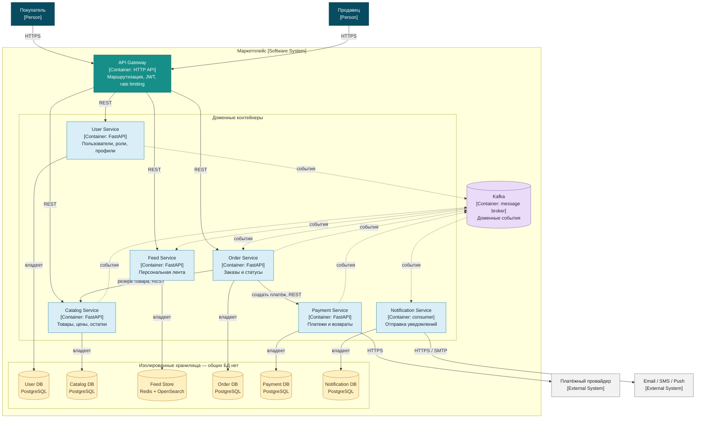

# Так называемое C4 Container diagram

## События

| Источник | События | Получатели |
|---|---|---|
| User Service | `UserRegistered` | Feed Service |
| Catalog Service | `ProductCreated`, `ProductUpdated` | Feed Service |
| Order Service | `OrderCreated`, `OrderStatusChanged` | Feed Service, Notification Service |
| Payment Service | `PaymentSucceeded`, `PaymentFailed` | Order Service, Notification Service |

