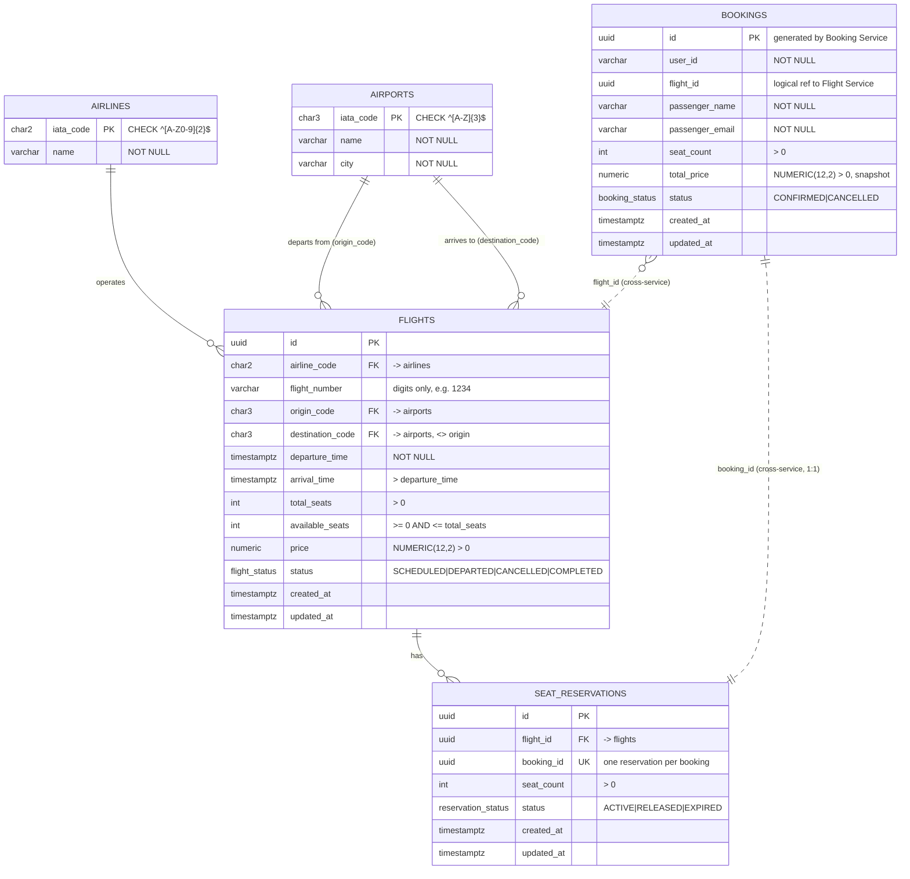

# ER-диаграмма (3NF)

Две независимые БД. Связь `bookings.flight_id → flights.id` и `seat_reservations.booking_id ↔ bookings.id`
логическая (через gRPC), без внешнего ключа: у каждого сервиса своя база.

Уникальность «номер рейса + дата вылета»: `UNIQUE (airline_code, flight_number, utc_date(departure_time))`.

## Почему это 3NF

- **1NF** — все атрибуты атомарны: маршрут хранится двумя отдельными кодами, номер рейса не склеен с авиакомпанией.
- **2NF** — во всех таблицах простой первичный ключ (`id` / IATA-код), частичных зависимостей нет.
- **3NF** — нет транзитивных зависимостей от ключа:
  - название авиакомпании зависит от `airline_code`, а не от рейса, поэтому вынесено в `airlines`;
  - название и город аэропорта зависят от IATA-кода, поэтому вынесены в `airports`;
  - префикс номера рейса (`SU` в `SU1234`) определяется авиакомпанией, поэтому в `flights` хранится только
    цифровая часть, а полный номер собирается как `airline_code || flight_number`;
  - дата вылета не хранится отдельно (она выводится из `departure_time`), уникальность по дате обеспечивает
    индекс по выражению.
- **Осознанная денормализация:** `available_seats` можно вычислить как `total_seats − SUM(seat_count)` по ACTIVE-резервациям,
  но ТЗ требует хранить счётчик. Он меняется только внутри транзакций ReserveSeats/ReleaseReservation под
  `SELECT … FOR UPDATE` и защищён `CHECK (available_seats BETWEEN 0 AND total_seats)`.
- `bookings.total_price` — это снимок цены на момент бронирования, а не производное поле: текущая цена рейса может измениться.
