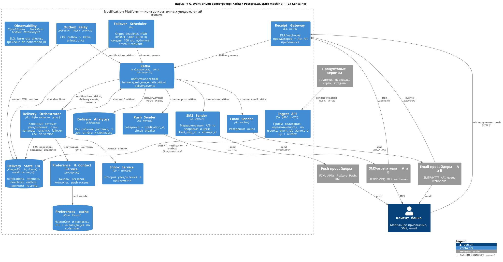
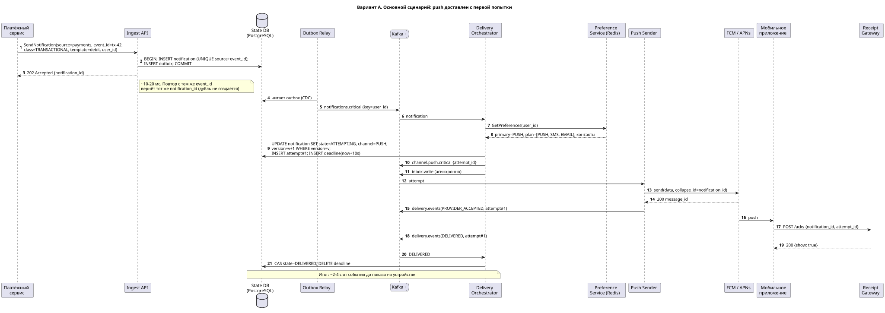
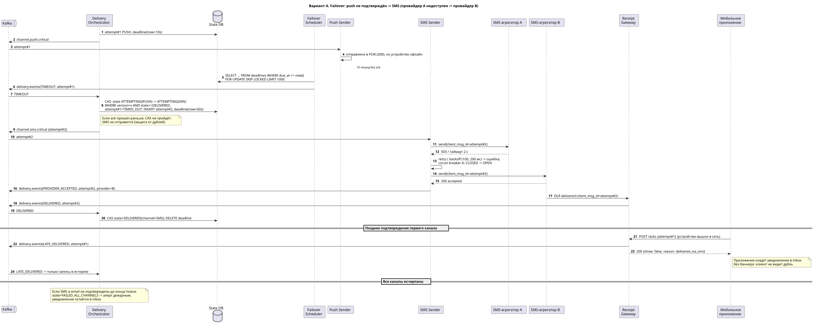
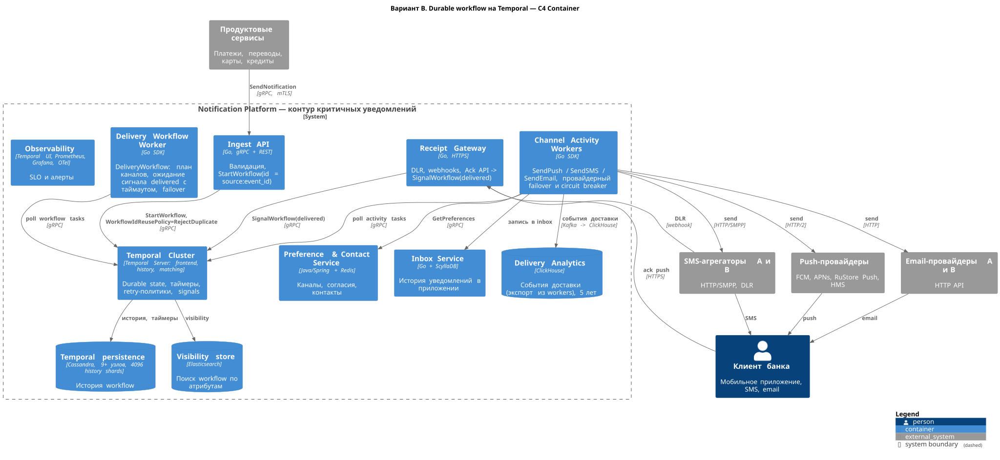
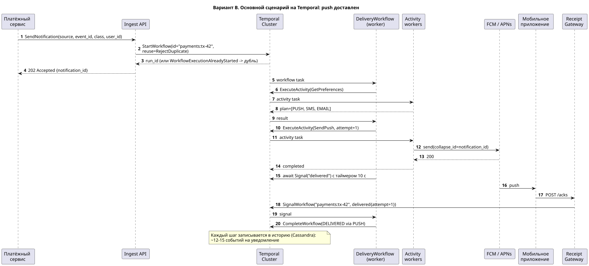
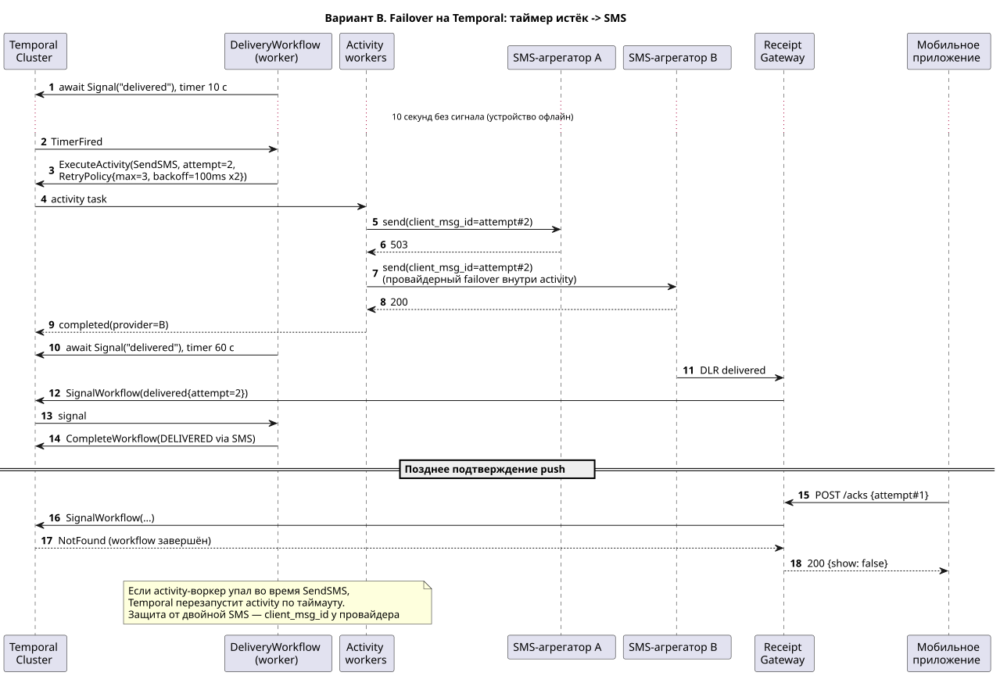
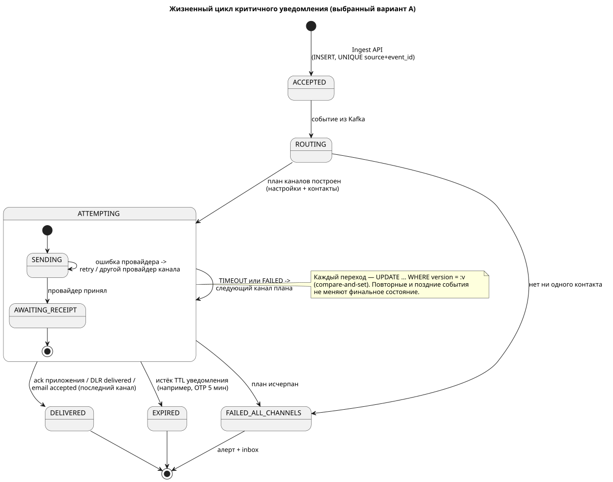

# RFC-001: Гарантированная доставка критичных уведомлений с кросс-канальным failover

| | |
|---|---|
| **Статус** | Предложено (Proposed) |
| **Автор** | tsm-pol |
| **Дата** | 2026-11-12 |
| **Область** | Notification Platform → подсистема доставки транзакционных уведомлений |
| **Связанные документы** | [01-requirements.md](01-requirements.md) — ФТ, НФТ и ASR всей платформы (задания 1–7) |

## Содержание
1. [Контекст и проблема](#1-контекст-и-проблема)
2. [Цели и не-цели](#2-цели-и-не-цели)
3. [Требования к подсистеме](#3-требования-к-подсистеме)
4. [ASR и приоритеты](#4-asr-и-приоритеты)
5. [Масштаб и расчёт нагрузки](#5-масштаб-и-расчёт-нагрузки)
6. [Общие решения для обоих вариантов](#6-общие-решения-для-обоих-вариантов)
7. [Вариант A: event-driven оркестратор на Kafka + PostgreSQL](#7-вариант-a-event-driven-оркестратор-на-kafka--postgresql)
8. [Вариант B: durable workflow на Temporal](#8-вариант-b-durable-workflow-на-temporal)
9. [Сравнение и выбор](#9-сравнение-и-выбор)
10. [Детальный дизайн выбранного варианта](#10-детальный-дизайн-выбранного-варианта-a)
11. [Компромиссы и ограничения](#11-компромиссы-и-ограничения)
12. [Риски и неопределённости](#12-риски-и-неопределённости)
13. [План внедрения](#13-план-внедрения)
14. [Открытые вопросы](#14-открытые-вопросы)

---

## 1. Контекст и проблема

Транзакционные уведомления (списание, зачисление, перевод, вход с нового устройства) обязательны: банк должен уведомлять
клиента об операциях (ст. 9 161-ФЗ), а недоставка — это и риск безопасности (клиент не узнает о мошеннической операции),
и прямой источник обращений в поддержку. Сейчас каждая продуктовая команда отправляет уведомления сама. Поэтому нет
подтверждения доставки, нет резервного канала, повторы приводят к дублям, и никто не может ответить на вопрос «дошло ли
уведомление клиенту X о списании Y».

Каналы различаются надёжностью, задержкой и стоимостью:

| Канал | Задержка | Подтверждение доставки | Стоимость (допущение) | Типичные отказы |
|---|---|---|---|---|
| **Push** (FCM, APNs, RuStore, HMS) | 0,5–3 с | Провайдер подтверждает только **приём**. Факт получения на устройстве даёт только **ack от приложения** | ≈ 0 ₽ | устройство офлайн, токен протух, push выключен в ОС, ограничения вендора |
| **SMS** (агрегаторы) | 3–15 с | **DLR** от оператора, асинхронно, часть DLR теряется | **≈ 2,5 ₽** | перегрузка агрегатора, сбой оператора, номер недоступен |
| **Email** (ESP) | 5 с – минуты | Только «принято почтовым сервером получателя» | ≈ 0,05 ₽ | спам-фильтры, нет email у клиента |

## 2. Цели и не-цели

**Цели**
- **G1.** Каждое принятое критичное уведомление доставлено хотя бы по одному каналу или явно эскалировано.
- **G2.** Автоматический failover между каналами и между провайдерами одного канала.
- **G3.** Учёт настроек клиента: основной канал; транзакционные отключить нельзя.
- **G4.** Минимальная стоимость: push в первую очередь, SMS — когда push не сработал или клиент выбрал SMS.
- **G5.** Отсутствие дублей при повторах и failover (насколько это физически возможно).
- **G6.** Полная наблюдаемость жизненного цикла каждого уведомления.

**Не-цели**
- Маркетинговые и массовые рассылки: отдельный контур с отдельными топиками и обработчиками. Здесь учитывается только изоляция от него.
- OTP-коды для входа: отдельный сценарий аутентификации со своими TTL и требованиями. Его можно позже подключить на ту же подсистему как класс с `TTL = 5 мин` и планом `[SMS]`.
- Редактор шаблонов, сегментация, A/B-тесты.
- Мессенджеры, голосовые звонки — возможные будущие каналы. Архитектура допускает их добавление как ещё одного Channel Sender.

## 3. Требования к подсистеме

Детализация ФТ и НФТ из [01-requirements.md](01-requirements.md) применительно к доставке критичных уведомлений.

### 3.1 Функциональные

| ID | Требование | Источник |
|---|---|---|
| **RF-1** | Принять уведомление от продуктового сервиса и подтвердить приём только после надёжной записи; повтор с тем же `(source, event_id)` возвращает тот же `notification_id`, нового уведомления не создаётся | FR-1, FR-4 |
| **RF-2** | Построить план каналов по классу уведомления, настройкам клиента и доступным контактам (push-токен, телефон, email) | FR-2, FR-3 |
| **RF-3** | Отправить по текущему каналу и ждать подтверждения доставки не дольше таймаута канала; при отказе или таймауте перейти к следующему каналу плана | FR-2 |
| **RF-4** | При ошибке провайдера переключиться на другого провайдера того же канала, не дожидаясь таймаута канала | FR-2 |
| **RF-5** | Не отправлять следующий канал, если доставка по предыдущему уже подтверждена; поздние подтверждения не порождают новых отправок | FR-4 |
| **RF-6** | Запретить отключение транзакционных уведомлений; разрешить выбор основного канала (push или SMS) | FR-3 |
| **RF-7** | Если все каналы плана исчерпаны — зафиксировать `FAILED_ALL_CHANNELS`, оставить уведомление в inbox приложения и поднять алерт | FR-6, FR-7 |
| **RF-8** | Предоставить поддержке хронологию уведомления: попытки, каналы, провайдеры, статусы, время | FR-7 |

### 3.2 Нефункциональные

| ID | Атрибут | Метрика |
|---|---|---|
| **RN-1** | Задержка | Приём → передача провайдеру: p95 ≤ 1 с, p99 ≤ 2 с. Приём → подтверждённая доставка по первому каналу: p95 ≤ 5 с. С failover на SMS: p99 ≤ 30 с |
| **RN-2** | Надёжность | RPO = 0 для принятых уведомлений. ≥ 99,99% доставлены или эскалированы ≤ 2 мин. 0 уведомлений, «застрявших» в незавершённом статусе дольше 5 мин |
| **RN-3** | Доступность | Приём 99,99% в месяц. Переживает отказ любого провайдера, любого экземпляра сервиса и одного ЦОД (RTO ≤ 5 мин) |
| **RN-4** | Производительность | 2 000 уведомлений/с устойчиво, 5 000/с всплеском 5 мин. Рост ×3 — горизонтально |
| **RN-5** | Дубли | Тот же канал: ≤ 0,01%. Разные каналы: ≤ 0,5% от случаев failover |
| **RN-6** | Стоимость | Доля SMS ≤ 25% транзакционных |
| **RN-7** | Наблюдаемость | Статус виден ≤ 5 с после события. Деградация провайдера или канала обнаружена ≤ 1 мин |
| **RN-8** | Безопасность | PII зашифрованы, хранятся в РФ. Ack от устройства нельзя подделать (подписанный токен попытки). Аудит ≥ 5 лет |

## 4. ASR и приоритеты

| Приоритет | ASR | Источник в 01-requirements | Требования RFC |
|---|---|---|---|
| **P1** | **ASR-1** Гарантированная доставка с failover: состояние уведомления и таймеры переживают любой сбой | ASR-1 | RF-1, RF-3, RF-7, RN-2 |
| **P1** | **ASR-2** Низкая задержка, не зависящая от массовых рассылок | ASR-2 | RN-1, RN-4 |
| **P1** | **ASR-3** Устойчивость к нестабильным провайдерам | ASR-3 | RF-4, RN-3 |
| **P2** | **ASR-4** Идемпотентность и отсутствие дублей при повторах и failover | ASR-4 | RF-1, RF-5, RN-5 |
| **P2** | **ASR-5** Минимизация стоимости при соблюдении настроек клиента | ASR-7 + NFR-7 | RF-2, RF-6, RN-6 |
| **P2** | **ASR-6** Сквозная наблюдаемость | ASR-6 | RF-8, RN-7 |
| **P3** | **ASR-7** Масштабируемость ×3 без смены архитектуры | ASR-5 | RN-4 |

При конфликтах действует порядок **P1 > P2 > P3**. Пример: гарантия доставки (ASR-1) важнее, чем отсутствие
межканального дубля (ASR-4). Поэтому при сомнении система отправит SMS, а не будет ждать дальше.

---

## 5. Масштаб и расчёт нагрузки

### 5.1 Входной поток

| Величина | Расчёт | Значение |
|---|---|---|
| Все уведомления в сутки | 3 млн DAU × 10 | **30 млн/сут** (~347/с в среднем) |
| Транзакционные в сутки | 3 млн × 2 | **6 млн/сут** (~70/с в среднем) |
| Пик, оценка 1 (по суточному профилю) | 10% суточного объёма в пиковый час = 600 тыс./ч = 167/с; внутри часа всплески ×5 | **~830/с** |
| Пик, оценка 2 (по PCU) | 300 тыс. одновременных пользователей; активный клиент делает операцию раз в ~5 мин → 1 000 операций/с; одна операция порождает ~1,3 уведомления (списание у плательщика + зачисление у получателя) | **~1 300/с** |
| **Целевая пропускная способность** | max(оценок) × 1,5 запаса | **2 000/с устойчиво, 5 000/с всплеск** |

Маркетинговая кампания на 1 млн за 60 мин добавляет ~280/с в **отдельный** контур. В расчёт подсистемы она не входит,
но требует изоляции у провайдеров (раздел 10.6).

### 5.2 Каналы и стоимость

Допущения (подлежат проверке, см. U1 и U2): у 85% клиентов есть рабочий push-токен; 15% подключили платное SMS-информирование
(для них SMS — основной канал); 8% push-попыток не получают ack за 10 с; 2% SMS не получают DLR delivered за 60 с.

| Величина | Расчёт | Значение |
|---|---|---|
| Push-отправки | 6 млн × 0,85 | 5,1 млн/сут, пик ~1 700/с |
| Failover push → SMS | 5,1 млн × 0,08 | 408 тыс./сут, ~136/с в пике |
| SMS всего | 6 млн × (0,15 + 0,85 × 0,08) = 6 млн × 0,218 | **1,31 млн/сут (21,8%)**, пик **~440/с** |
| Failover SMS → email | 1,31 млн × 0,02 | ~26 тыс./сут |
| Попыток на уведомление | 1 + 0,068 + 0,218 × 0,02 | **≈ 1,07** |
| Стоимость SMS при push-first | 1,31 млн × 2,5 ₽ | **≈ 3,3 млн ₽/сут ≈ 98 млн ₽/мес** |
| Стоимость при SMS для всех | 6 млн × 2,5 ₽ | ≈ 15 млн ₽/сут ≈ 450 млн ₽/мес |
| **Экономия push-first** | | **≈ 78%** (~350 млн ₽/мес) |

Вывод: каждые +10 секунд таймаута push почти не меняют стоимость, а каждые +1 п.п. доли failover — это ~1,5 млн ₽/мес.
Поэтому таймаут push выбирается по распределению времени ack (U1), а не «чем короче, тем лучше».

SMS-агрегаторы: пик ~440 SMS/с. Каждый из двух агрегаторов по договору должен выдерживать **≥ 500 SMS/с**, чтобы
при отказе одного второй принял весь транзакционный поток.

### 5.3 Брокер (Kafka)

| Величина | Расчёт | Значение |
|---|---|---|
| Сообщений на уведомление | ingest 1 + команда в канал 1,07 + события (принято провайдером 1,07, delivered/timeout ~1,1) + inbox 1 | ≈ 5,3 |
| Пиковый поток | 2 000 × 5,3 × ~1 КБ | ~10,6 тыс. сообщений/с, **~11 МБ/с** |
| Суточный объём | 6 млн × 5,3 × 1 КБ × RF 3 | ~96 ГБ/сут; хранение 7 дней ≈ **0,7 ТБ** на кластер |

Это ~10% возможностей минимального кластера из 3 брокеров (каждый держит 100+ МБ/с), то есть запас ×10 для пиков и роста.
Партиций: 48 для `notifications.critical` (до 48 параллельных экземпляров оркестратора), по 24 для канальных топиков.

### 5.4 Хранилище состояния (вариант A)

| Величина | Расчёт | Значение |
|---|---|---|
| Транзакций БД на уведомление | приём (notification + outbox) · старт попытки (CAS + attempt + deadline) · «принято провайдером» · «доставлено» (CAS + attempt + delete deadline) · очистка outbox | ~5–6 транзакций, ~10 изменений строк |
| Пиковая нагрузка | 2 000 × 6 | **~12 тыс. транзакций/с** (~20 тыс. изменений строк/с) |
| Один PostgreSQL primary на NVMe | реалистично 10–15 тыс. коротких транзакций/с | на пределе, без запаса |
| **4 шарда** (hash по `user_id`) | 12 тыс. / 4 | **~3 тыс. транзакций/с на шард**, запас ×3–4 |
| Объём горячих данных | 6 млн × ~2,2 КБ (строка + попытки + индексы) | ~13 ГБ/сут; 30 дней ≈ 400 ГБ (≈ 100 ГБ на шард), партиции по дням удаляются `DROP PARTITION` |
| Активные таймеры | push: 1 700/с × 10 с + SMS: 440/с × 60 с | ~**43 тыс.** строк в `deadlines`, срабатывает ~150/с |
| Архив (ClickHouse) | 6 млн × 5 событий × 0,3 КБ = 9 ГБ/сут, сжатие ×8 | ~1,1 ГБ/сут, **~2 ТБ за 5 лет** |

### 5.5 Прочее

- Ack от приложений: ~4,7 млн/сут, пик ~1 600 HTTPS-запросов/с → 4–6 экземпляров Receipt Gateway. DLR: пик ~440/с.
- Чтение настроек: 2 000/с из Redis, hit ratio > 99%. Нагрузка незначительна.
- Нагрузка Temporal для варианта B посчитана в разделе 8.4.

---

## 6. Общие решения для обоих вариантов

Эти решения не зависят от выбора оркестрации и входят в оба варианта.

1. **Определение «доставлено»** (ответ на Q1 из 01-requirements):
   - **Push** — ack от приложения. Push отправляется как data-message с `notification_id`, `attempt_id` и подписанным
     токеном попытки. Android обрабатывает его в `FirebaseMessagingService`, iOS — в Notification Service Extension
     (`mutable-content: 1`). Приложение вызывает `POST /acks` до показа баннера. Ответ `200 OK` от FCM/APNs означает только «принято провайдером».
   - **SMS** — DLR со статусом `DELIVERED`.
   - **Email** — событие `delivered` от ESP (принято почтовым сервером получателя). Это последний и самый слабый канал.
2. **Политика каналов** задаётся декларативно по классу уведомления и настройкам клиента (раздел 10.3). Email никогда не основной канал для транзакционных: слишком велика задержка.
3. **Провайдерный failover внутри канала**: ≥ 2 провайдера SMS и email; circuit breaker, таймаут 2 с, до 2 повторов с backoff 100/200 мс. Только после этого — переход к следующему каналу.
4. **Идемпотентность на всех уровнях**: `(source, event_id)` → `notification_id` → `attempt_id` → `client_msg_id` у провайдера, `apns-collapse-id` / Android `tag` = `notification_id` (устройство заменяет, а не дублирует).
5. **Inbox**: каждое критичное уведомление пишется в историю в приложении независимо от исхода доставки.
6. **Изоляция от массового контура**: отдельные топики, consumer group, пулы обработчиков, отдельные аккаунты или имена отправителя у SMS-агрегаторов.

---

## 7. Вариант A: event-driven оркестратор на Kafka + PostgreSQL

### 7.1 Архитектура

Состояние каждого уведомления — явный конечный автомат в шардированном PostgreSQL. Все компоненты общаются через Kafka.
Таймеры failover хранятся в той же БД (таблица `deadlines`), их опрашивает Failover Scheduler. Приём выполняется по паттерну
transactional outbox: строка уведомления и событие для Kafka пишутся в одной транзакции.



Исходник: [diagrams/c4-option-a.puml](diagrams/c4-option-a.puml)

| Контейнер | Ответственность | Технология |
|---|---|---|
| Ingest API | Приём, валидация, идемпотентность, запись notification + outbox | Go, gRPC/REST, mTLS |
| Delivery State DB | notifications, attempts, deadlines, outbox | PostgreSQL 16, 4 шарда, Patroni (синхронная реплика во 2-м ЦОД), партиции по дням |
| Outbox Relay | outbox → Kafka | Debezium (Kafka Connect) |
| Kafka | Транспорт команд и событий | Apache Kafka 3.x, растянутый кластер на 3 площадки, RF = 3, `min.insync.replicas = 2`, `acks = all` |
| Delivery Orchestrator | Конечный автомат: план, попытки, failover, CAS | Go, consumer group (масштабирование до числа партиций) |
| Failover Scheduler | Срабатывание таймеров | Go, `SELECT … FOR UPDATE SKIP LOCKED` раз в 100 мс на шард |
| Preference & Contact Service | Настройки, согласия, контакты, push-токены | Java/Spring + PostgreSQL + Redis Cluster |
| Push / SMS / Email Sender | Вызов провайдеров, провайдерный failover, rate limit | Go workers, circuit breaker |
| Receipt Gateway | DLR, webhooks, Ack API | Go, HTTPS |
| Inbox Service | История в приложении | Go + ScyllaDB |
| Delivery Analytics | События доставки, отчёты, стоимость, аудит | ClickHouse (Kafka engine) |
| Observability | Метрики, трейсы, алерты | OpenTelemetry, Prometheus, Grafana, Alertmanager |

### 7.2 Основной сценарий



Исходник: [diagrams/seq-a-main.puml](diagrams/seq-a-main.puml)

### 7.3 Сценарий failover

Push не подтверждён за 10 с → SMS. Первый SMS-агрегатор недоступен → второй. Потом приходит позднее подтверждение push.



Исходник: [diagrams/seq-a-failover.puml](diagrams/seq-a-failover.puml)

### 7.4 Как вариант A выполняет ASR

| ASR | Как выполняется |
|---|---|
| **ASR-1** Гарантия | Приём подтверждается после коммита в PostgreSQL с синхронной репликой (RPO = 0). Состояние и таймеры персистентны: при падении оркестратора Kafka отдаёт сообщения другому экземпляру, при падении Scheduler — дедлайны забирает другой экземпляр (`SKIP LOCKED`). Reconciliation job раз в минуту находит уведомления без финального статуса и без дедлайна и запускает их заново |
| **ASR-2** Задержка | Бюджет p95: приём 15 мс + outbox→Kafka ~100 мс + оркестратор (Redis + CAS) 30 мс + Kafka→Sender 10 мс + FCM 150 мс ≈ **0,3 с до провайдера** (цель ≤ 1 с). Отдельные топики и пулы — массовый контур их не задевает |
| **ASR-3** Провайдеры | Circuit breaker и провайдерный failover в Sender'ах; статусы приходят асинхронно через Receipt Gateway; таймер failover срабатывает, даже если провайдер «молча» потерял сообщение |
| **ASR-4** Дубли | UNIQUE `(source, event_id)`; переходы через `version` (CAS); канальная команда идемпотентна по `attempt_id`; `client_msg_id` и `collapse-id` у провайдеров; позднее подтверждение → `show: false` в приложении |
| **ASR-5** Стоимость | Push-first по умолчанию, SMS только по таймауту или выбору клиента. Расчёт: доля SMS 21,8% (цель ≤ 25%) |
| **ASR-6** Наблюдаемость | Каждый переход — событие в `delivery.events` → ClickHouse; трейс OTel по `notification_id`; Status API; метрики и алерты (раздел 10.7) |
| **ASR-7** Масштаб | Всё без состояния, кроме БД и Kafka. Оркестратор масштабируется до 48 экземпляров; БД — добавлением шардов. Рост ×3 = 36 тыс. транзакций/с → 12 шардов по 3 тыс. |

### 7.5 Плюсы и минусы

**Плюсы**
- Kafka и PostgreSQL — стандартные для банка технологии; та же Kafka используется массовым контуром. Одна экспертиза, одни runbook'и.
- Предсказуемая задержка: минимальное число сетевых шагов, нет дополнительного движка между компонентами.
- Полный контроль над логикой маршрутизации и стоимости.
- Масштабируется линейно и независимо по компонентам (Sender'ы отдельно от оркестратора).

**Минусы**
- Свой код автомата, таймеров и reconciliation. Ошибки в нём могут «подвесить» уведомление; нужны тщательные тесты (раздел 11).
- Распределённое состояние: БД, Kafka и outbox. Нужно аккуратно обеспечить идемпотентность каждого потребителя.
- Хронологию уведомления надо собирать самим (ClickHouse + Status API); готового UI нет.

---

## 8. Вариант B: durable workflow на Temporal

### 8.1 Архитектура

Каждое критичное уведомление — экземпляр `DeliveryWorkflow` в Temporal, где `workflow_id = source:event_id`
(повторный старт отклоняется — это идемпотентность приёма). Логика failover написана обычным кодом:
`SendPush → await(signal "delivered", 10 s) → SendSMS → await(signal, 60 s) → SendEmail`. Temporal гарантирует, что
состояние, таймеры и повторы activity переживут любые рестарты. Подтверждения от Receipt Gateway доставляются в workflow
как сигналы.



Исходник: [diagrams/c4-option-b.puml](diagrams/c4-option-b.puml)

| Контейнер | Технология |
|---|---|
| Ingest API | Go, gRPC/REST → `StartWorkflow` |
| Temporal Cluster | Temporal Server (frontend, history, matching, worker), 4 096 history shards |
| Persistence | Cassandra (9–12 узлов, 2 ЦОД), visibility — Elasticsearch |
| Delivery Workflow Worker | Go SDK |
| Channel Activity Workers | Go SDK: SendPush, SendSMS, SendEmail, провайдерный failover |
| Receipt Gateway | Go, `SignalWorkflow` |
| Preference Service, Inbox, ClickHouse, Observability | как в варианте A; плюс Temporal Web UI |

### 8.2 Основной сценарий



Исходник: [diagrams/seq-b-main.puml](diagrams/seq-b-main.puml)

### 8.3 Сценарий failover



Исходник: [diagrams/seq-b-failover.puml](diagrams/seq-b-failover.puml)

### 8.4 Нагрузка на Temporal

| Величина | Расчёт | Значение |
|---|---|---|
| Событий истории на workflow | старт, 4 workflow task × 3 события, 2 activity × 3, таймер, сигнал, завершение | ~22 (с failover ~35) |
| Поток событий в пике | 2 000 × ~23 | **~45 тыс. событий/с** |
| Записи в Cassandra | ~8–10 батчей на workflow × 2 000 | ~16–20 тыс. записей/с (× RF 3) |
| Записи visibility (ES) | ~4 на workflow × 2 000 | ~8 тыс./с |
| Одновременно открытых workflow | 2 000/с × ~10 с + SMS-хвост | ~45 тыс. |

Это нагрузка «большого» самостоятельного кластера Temporal: 6–10 подов history, Cassandra на 9–12 узлах, ES на 3–5 узлах
**в каждом ЦОД**. Temporal Cloud не подходит: данные должны храниться в РФ (152-ФЗ), есть санкционные риски.

### 8.5 Как вариант B выполняет ASR

| ASR | Как выполняется |
|---|---|
| **ASR-1** Гарантия | Сильная сторона: durable execution — состояние, таймеры и повторы activity хранит Temporal; при падении воркера выполнение продолжается с последнего шага. Отказоустойчивость самого Temporal между ЦОД — multi-cluster replication (асинхронная, RPO > 0) или растянутая Cassandra |
| **ASR-2** Задержка | Каждый шаг — round-trip в Temporal (~10–30 мс). До `SendPush` 3–4 шага → **~0,1–0,2 с** до провайдера; укладывается в цель. Изоляция от массового контура — отдельные task queues и namespace |
| **ASR-3** Провайдеры | `RetryPolicy` activity + провайдерный failover внутри activity; таймеры ожидания — durable timers |
| **ASR-4** Дубли | `WorkflowIdReusePolicy = RejectDuplicate` при приёме; сигнал в завершённый workflow отклоняется. Повтор activity после падения воркера может повторно вызвать провайдера → нужны `client_msg_id` и collapse-id, как в A |
| **ASR-5** Стоимость | Та же политика push-first, записанная кодом workflow |
| **ASR-6** Наблюдаемость | Temporal UI показывает историю каждого workflow «из коробки»; метрики SDK. Для аналитики и 5-летнего аудита всё равно нужен экспорт в ClickHouse: retention истории в Temporal — дни |
| **ASR-7** Масштаб | Горизонтально, но число history shards задаётся при создании кластера и не меняется: его надо сразу брать с запасом. Рост ×3 = ~135 тыс. событий/с — это крупный кластер Cassandra |

### 8.6 Плюсы и минусы

**Плюсы**
- Минимум своего кода инфраструктуры: таймеры, повторы, состояние и восстановление после сбоев даёт Temporal.
- Логика failover читается как последовательный код, её легко менять и тестировать (Temporal test framework, replay).
- Готовая визуализация каждого уведомления (Temporal UI).

**Минусы**
- Три новых сложных stateful-системы для банка (Temporal, Cassandra, Elasticsearch), каждой нужны SLA 99,99%, DR и экспертиза.
- Temporal становится единой точкой отказа всего критичного контура; кросс-ЦОД репликация асинхронная (RPO > 0).
- Накладные расходы: ~45 тыс. событий истории в секунду ради автомата из 3–4 шагов.
- Ограничения модели: детерминизм кода workflow, версионирование при изменении логики, фиксированное число shards.

---

## 9. Сравнение и выбор

| Критерий (вес) | Вариант A: Kafka + PostgreSQL | Вариант B: Temporal |
|---|---|---|
| Гарантия доставки, ASR-1 (высокий) | ✅ RPO = 0 (синхронная реплика), но корректность зависит от своего кода | ✅ durable execution «из коробки»; кросс-ЦОД RPO > 0 |
| Задержка, ASR-2 (высокий) | ✅ ~0,3 с до провайдера | ✅ ~0,1–0,2 с до провайдера, но зависит от здоровья кластера Temporal |
| Устойчивость к провайдерам, ASR-3 (высокий) | ✅ одинаково (Sender'ы) | ✅ одинаково (activities) |
| Дубли, ASR-4 (средний) | ✅ CAS + ключи идемпотентности | ✅ workflow id + те же ключи у провайдеров |
| Стоимость доставки, ASR-5 (средний) | одинаково | одинаково |
| Наблюдаемость, ASR-6 (средний) | ⚠️ хронологию надо собирать самим (ClickHouse + Status API) | ✅ Temporal UI + всё равно ClickHouse для аудита |
| Масштаб, ASR-7 (низкий) | ✅ линейно: партиции + шарды | ⚠️ shards фиксированы, большой кластер Cassandra |
| Эксплуатационная сложность | ✅ знакомые компоненты, уже есть в банке (допущение) | ❌ +Temporal +Cassandra +ES, нужна новая экспертиза |
| Объём своего кода и риск ошибок | ❌ автомат, таймеры, reconciliation | ✅ минимальный |
| Стоимость инфраструктуры (порядок) | ~3 узла Kafka на ЦОД (общий с массовым контуром) + 4 шарда PG × 3 узла | Kafka для событий + Temporal + Cassandra 9–12 + ES 3–5 на ЦОД |
| Гибкость будущих сценариев (эскалации, многодневные напоминания) | ⚠️ каждый новый шаблон — доработка автомата | ✅ сильная сторона |

### Решение: **вариант A** (event-driven оркестратор на Kafka + PostgreSQL)

Обоснование:
1. **Задача — короткий ограниченный автомат.** Максимум 3 канала, 2 таймера, время жизни ≤ 2 минут. Главное преимущество Temporal — долгие сложные workflow — здесь почти не используется, а его цена (~45 тыс. событий/с, три новых кластера) платится полностью.
2. **Надёжность определяется самым слабым звеном.** В варианте B критичный контур зависит от новых для банка систем, у которых нет отработанных runbook'ов и DR-процедур. Кросс-ЦОД репликация Temporal асинхронная, а у PostgreSQL с синхронной репликой RPO = 0, что прямо следует из NFR-2.
3. **Единая платформа.** Kafka уже нужна массовому контуру и аналитике (события → ClickHouse). Вариант A добавляет к ней только PostgreSQL, которым банк умеет управлять.
4. **Предсказуемое масштабирование:** партиции Kafka и шарды PostgreSQL растут линейно, расчёт в 5.4 показывает запас ×3–4.

Риск варианта A — собственный код автомата — компенсируется мерами из раздела 11. **Условие пересмотра:** если появятся
многошаговые сценарии длиной в часы или дни (эскалация в колл-центр, цепочки напоминаний) или автомат разрастётся больше
~10 состояний — вернуться к варианту B для этих сценариев.

---

## 10. Детальный дизайн выбранного варианта A

### 10.1 Модель данных (PostgreSQL, на каждом шарде)

```sql
CREATE TABLE notifications (
    id              UUID PRIMARY KEY,
    source          TEXT NOT NULL,           -- команда-отправитель
    event_id        TEXT NOT NULL,           -- id бизнес-события у отправителя
    user_id         UUID NOT NULL,           -- ключ шардирования
    class           TEXT NOT NULL,           -- TRANSACTIONAL | SECURITY ...
    template_id     TEXT NOT NULL,
    payload_enc     BYTEA NOT NULL,          -- параметры шаблона, зашифрованы (PII)
    plan            TEXT[] NOT NULL,         -- например {PUSH,SMS,EMAIL}
    plan_step       SMALLINT NOT NULL DEFAULT 0,
    state           TEXT NOT NULL,           -- ACCEPTED | ROUTING | ATTEMPTING | DELIVERED | FAILED_ALL_CHANNELS | EXPIRED
    delivered_via   TEXT,
    version         INT NOT NULL DEFAULT 0,  -- optimistic locking (CAS)
    expires_at      TIMESTAMPTZ,
    created_at      TIMESTAMPTZ NOT NULL DEFAULT now(),
    UNIQUE (source, event_id)                -- идемпотентность приёма
) PARTITION BY RANGE (created_at);

CREATE TABLE attempts (
    id              UUID PRIMARY KEY,        -- = client_msg_id у провайдера
    notification_id UUID NOT NULL,
    step            SMALLINT NOT NULL,
    channel         TEXT NOT NULL,           -- PUSH | SMS | EMAIL
    provider        TEXT,
    status          TEXT NOT NULL,           -- CREATED | SENDING | PROVIDER_ACCEPTED | DELIVERED | FAILED | TIMED_OUT | UNKNOWN
    provider_msg_id TEXT,
    error           TEXT,
    created_at      TIMESTAMPTZ NOT NULL DEFAULT now(),
    updated_at      TIMESTAMPTZ NOT NULL DEFAULT now(),
    UNIQUE (notification_id, step)           -- не больше одной попытки на шаг плана
);

CREATE TABLE deadlines (
    notification_id UUID PRIMARY KEY,
    attempt_id      UUID NOT NULL,
    due_at          TIMESTAMPTZ NOT NULL
);
CREATE INDEX ON deadlines (due_at);
```

### 10.2 Конечный автомат и защита от гонок



Каждое событие (`DELIVERED`, `FAILED`, `TIMEOUT`) обрабатывается одной транзакцией:

```sql
UPDATE notifications
   SET state = 'ATTEMPTING', plan_step = plan_step + 1, version = version + 1
 WHERE id = :id AND version = :v AND state = 'ATTEMPTING' AND plan_step = :step;
-- 0 строк → событие устарело (уже доставлено или уже переключились) → только запись в историю
```

- `TIMEOUT` для шага N после того, как `DELIVERED` уже зафиксирован, ничего не делает → SMS не отправляется.
- Повторная доставка сообщения из Kafka (at-least-once) проходит тот же CAS и становится no-op.
- `UNIQUE (notification_id, step)` не даёт создать две попытки на один шаг даже при гонке двух экземпляров.

### 10.3 Политика каналов и пользовательские настройки

| Класс / условие | План каналов (таймаут ожидания подтверждения) | Отключение |
|---|---|---|
| Транзакционное, по умолчанию | PUSH (10 с) → SMS (60 с) → EMAIL | ❌ нельзя |
| Клиент выбрал SMS основным (SMS-информирование) | SMS (60 с) → PUSH (10 с) → EMAIL | ❌ нельзя; можно вернуть push основным |
| Нет валидного push-токена или push выключен в ОС | SMS (60 с) → EMAIL | — |
| Безопасность (вход с нового устройства, смена пароля) | SMS (60 с) → PUSH (10 с) | ❌ нельзя |
| Нет телефона и push-токена | EMAIL → `FAILED_ALL_CHANNELS` + inbox + алерт | — |

- Тихие часы к транзакционным не применяются.
- Таймаут push 10 с — стартовое значение. Окончательное значение = p95–p99 времени ack по результатам пилота (U1). Таймауты хранятся в конфигурации и меняются без деплоя.
- Канал пропускается сразу, без ожидания таймаута, если Sender вернул постоянную ошибку (токен невалиден, номер не существует) или circuit breaker всех провайдеров канала открыт.

### 10.4 Идемпотентность и дубли

| Источник дубля | Мера |
|---|---|
| Продуктовый сервис повторил запрос | `UNIQUE (source, event_id)`, ответ — существующий `notification_id` |
| Kafka доставила событие оркестратору повторно | CAS по `version` и `plan_step` |
| Команда в канал доставлена Sender'у повторно | Перед вызовом провайдера: `UPDATE attempts SET status='SENDING' WHERE id=:a AND status='CREATED'`; 0 строк — пропуск |
| Sender упал после вызова провайдера, но до записи результата (`SENDING`, исход неизвестен) | SMS: запрос статуса по `client_msg_id` или повтор с тем же `client_msg_id` (провайдер обязан дедуплицировать — требование договора). Push: повтор с тем же `collapse-id`, устройство заменит уведомление |
| Push дошёл после переключения на SMS | SMS отозвать нельзя. Приложение получает `show: false` и кладёт уведомление в inbox без баннера, так что клиент видит только одно сообщение (SMS) |

Остаточный риск: клиент видит и SMS, и push, если устройство оказалось онлайн в момент между отправкой SMS и ack, а
приложение не успело учесть ответ. Ожидаемо ≤ 0,5% от failover (≈ 2 тыс. случаев в сутки); измеряется метрикой
`late_ack_after_failover`. Это осознанный компромисс в пользу гарантии (P1 > P2).

### 10.5 Провайдеры и отказоустойчивость

- Circuit breaker на каждого провайдера: OPEN при доле ошибок > 20% за 30 с или при 10 таймаутах подряд; HALF_OPEN через 15 с, пробный трафик 1%.
- Маршрутизация SMS: взвешенная по здоровью (доля DLR delivered за 5 мин), затем по цене. Каждый агрегатор принимает 100% транзакционного трафика по договору.
- Синтетический мониторинг: раз в минуту канареечное уведомление на тестовые устройства и SIM каждого оператора через каждого провайдера.
- Сбой ЦОД:
  - Kafka — растянутый кластер на 3 площадки (2 ЦОД + арбитр), реплики распределены по площадкам.
  - PostgreSQL — синхронная реплика во втором ЦОД, переключение через Patroni (RTO ≤ 1 мин).
  - Сервисы без состояния работают в обоих ЦОД (active-active).
- Задержка Outbox Relay или Kafka не приводит к потере: строка уже в БД, reconciliation отправит её повторно.

### 10.6 Изоляция от массового контура

- Отдельные топики (`*.critical` и `*.bulk`) и consumer group; у Sender'ов отдельные пулы для critical и bulk.
- Квота у SMS-агрегаторов: под critical зарезервировано ≥ 60% лимита аккаунта, либо отдельные аккаунты.
- Массовый контур ограничен token bucket и автоматически снижает скорость, если p95 critical-контура выше порога (backpressure).

### 10.7 Наблюдаемость

| Что | Как |
|---|---|
| Хронология уведомления | Status API (поддержка): из PostgreSQL для 30 дней, из ClickHouse — 5 лет |
| Трейсинг | OpenTelemetry, `trace_id` берётся у отправителя и передаётся в заголовках Kafka; атрибут `notification_id` |
| SLI / SLO | `time_to_provider` p95 ≤ 1 с; `time_to_delivered` p95 ≤ 5 с; `delivered_or_escalated_within_2m` ≥ 99,99% |
| Метрики по каналам и провайдерам | доля ack/DLR, задержка, доля failover, состояние circuit breaker, стоимость в сутки по команде-отправителю |
| Алерты | burn-rate SLO (быстрый за 5 мин и медленный за 1 ч); `stuck_notifications > 0` (нет финального статуса > 5 мин); доля DLR провайдера падает на > 10 п.п.; доля failover выше 15% (признак проблемы push) |
| Аудит | Все события доставки в ClickHouse 5 лет; PII только в зашифрованном виде |

### 10.8 Технологии (итог)

Go (сервисы доставки), Java/Spring (Preference Service), gRPC + mTLS (внутренние API), Apache Kafka 3.x,
Debezium, PostgreSQL 16 + Patroni (4 шарда), Redis Cluster, ScyllaDB (inbox), ClickHouse, OpenTelemetry,
Prometheus, Grafana, Alertmanager, Kubernetes. Push: FCM, APNs, RuStore Push, HMS. SMS: два агрегатора (HTTP/SMPP). Email: два ESP.

---

## 11. Компромиссы и ограничения

| Компромисс / ограничение | Что получаем | Чем платим | Как смягчаем |
|---|---|---|---|
| **Push-first вместо SMS-first** | −78% стоимости (~350 млн ₽/мес) | При недоставке push клиент ждёт до +10 с и SMS приходит позже | Таймаут по данным пилота; SMS-first для класса «безопасность» и по выбору клиента |
| **Гарантия важнее отсутствия дублей** | Ни одно критичное уведомление не теряется молча | ≤ 0,5% межканальных дублей при failover | `show: false` в приложении, collapse-id, метрика поздних ack |
| **«Доставлено» для push = ack приложения** | Реальное подтверждение, а не «принято FCM» | Нужна доработка мобильных приложений (iOS Notification Service Extension) | SDK и поэтапный rollout; для старых версий приложения — SMS-first |
| **Email = «принято сервером получателя»** | Последний резерв почти бесплатно | Письмо может попасть в спам, гарантия слабее | Email только последний шаг; inbox в приложении как источник истины |
| **Свой автомат вместо Temporal** | Знакомый стек, RPO = 0, меньше инфраструктуры | Свой код таймеров и reconciliation, риск ошибок | Табличное описание переходов, property-based тесты, chaos-тесты (kill оркестратора, Kafka, PG primary), reconciliation job, алерт на «застрявшие» |
| **Outbox через CDC** | Атомарность «запись + событие», нет потерь | +50–100 мс задержки и ещё один компонент (Debezium) | Укладываемся в бюджет 1 с; reconciliation подстраховывает отставание CDC |
| **Шардирование по `user_id`** | Линейный рост записи | Нет глобальных запросов по всем шардам | Аналитика и поиск идут в ClickHouse |

**Ограничения решения**
- Доставка не гарантируется клиенту без единого рабочего контакта: тогда `FAILED_ALL_CHANNELS`, inbox и алерт.
- SLA доставки ограничен SLA операторов связи и push-вендоров; платформа гарантирует попытки и переключение, но не работу сети оператора.
- Порядок доставки нескольких уведомлений одному клиенту не гарантирован между каналами (сохраняется только в пределах партиции `user_id`).

## 12. Риски и неопределённости

| # | Риск / неопределённость | Влияние | Проверка / митигация |
|---|---|---|---|
| R1 (U1) | Распределение времени ack push и доля устройств без ack | Таймаут, стоимость, дубли | Пилот на 1–5% аудитории 2 недели; таймаут = p95–p99 |
| R2 (U2) | Надёжность DLR у агрегаторов (потерянные DLR приводят к ложному failover в email) | Лишние письма, искажённые метрики | Нагрузочный тест в песочнице, сверка с биллингом, SLA по DLR в договоре |
| R3 (U3) | Реальный пиковый коэффициент | Нарушение RN-1 в пике | Анализ логов процессинга за год, нагрузочный тест на 2× пика (4 000/с) |
| R4 | Ограничения FCM/APNs для российских пользователей | Падает доля push → растёт стоимость SMS | Поддержка RuStore Push и HMS; мониторинг доли failover по вендору |
| R5 | Ошибки в коде автомата («зависшие» уведомления) | Нарушение гарантии | Reconciliation, алерт `stuck_notifications`, chaos-тесты, канареечные уведомления |
| R6 (U4) | Регуляторика: можно ли считать email уведомлением об операции по 161-ФЗ | Политика каналов | Заключение юристов и комплаенса до запуска |

## 13. План внедрения

1. **Пилот (6 недель).** Ingest, оркестратор, push и SMS-каналы для одной команды (переводы) в теневом режиме: старый механизм отправляет, новый пишет решения и метрики без отправки. Сбор данных для R1 и R2.
2. **Боевой запуск для переводов (4 недели).** Новый контур становится основным, старый отключается. Подбираем таймауты, проводим chaos-тесты и учения по переключению ЦОД.
3. **Миграция остальных команд (3 месяца).** SDK для продуктовых команд, единые шаблоны, политика `(source, event_id)`.
4. **Отказ от прямых интеграций** команд с провайдерами (договоры с провайдерами — только у платформы).

Критерии готовности к шагу 2: p95 `time_to_delivered` ≤ 5 с на теневом трафике, 0 потерь в chaos-тестах, доля SMS ≤ 25%.

## 14. Открытые вопросы

1. Какой окончательный таймаут push (10 с или 20 с)? Решается по результатам пилота (R1) и A/B-теста жалоб (U5 в 01-requirements).
2. Нужен ли платный «SMS всегда» как отдельный тариф, или достаточно выбора основного канала?
3. Отправлять ли уведомления класса «безопасность» сразу по двум каналам параллельно (SMS + push), принимая дубль ради скорости?
4. Срок хранения содержимого уведомлений (не только метаданных) — согласовать с комплаенсом.
